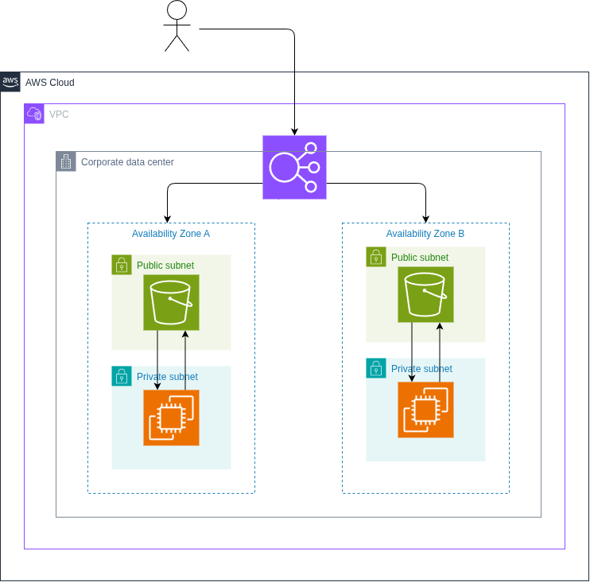

# Trabalho final de fundamentos em nuvem

O trabalho de avaliação final (obrigatório) consiste em:

- [ ] Elaborar uma aplicação web que possua um front-end funcional e que realize gravações e consultas em um banco de dados (DynamoDB e/ou RDS).

- [x] Criar um diagrama de arquitetura usando a ferramenta Draw.io que demonstre a implementação da aplicação elaborada com todos os detalhes da estrutura.

A aplicação deverá implementar a funcionalidade de HA (Multi AZ) na camada WEB (utilizando load balancer).

- [ ] Criar e implementar a aplicação no ambiente AWS em uma das contas (de qualquer componente do grupo) podendo ser utilizado EC2, ECS/EKS e/ou Lambda.

- [ ] Implementar ao menos uma ferramenta de monitoramento para o ambiente com dashboards funcionais (utilizar Grafana ou qualquer outro).

- [ ] Apresentar em aula utilizando um recurso (PPT/Canva) o descritivo da aplicação, sua funcionalidade, desenho da arquitetura e apresentar o MVP funcional da aplicação. Todos os componentes do grupo deverão subir o PDF da apresentação aqui nesta atividade para contabilização de nota.

OBS: Na apresentação deverá conter um slide com a divisão das tarefas que cada componente executou, assim como todos deverão apresentar (colocar no rodapé dos slides quem deverá falar nele).

As apresentações serão nos dias **02/12** e **09/12**.

